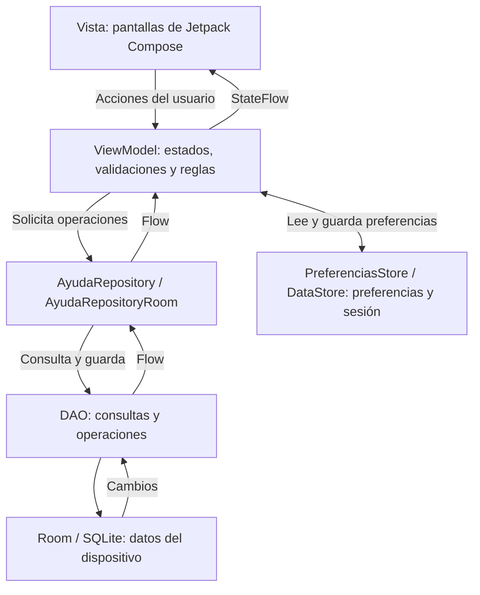

# AyudaCampus_Huanco

Grecia Huanco Ticona

## Descripción

En este proyecto desarrollo una mesa de ayuda para reportar problemas del campus, donde puedo entrar como estudiante para crear tickets, revisar su estado, conversar con Soporte TI y calificar la atención. También puedo entrar como Soporte TI para responder los tickets, cambiar su estado y prioridad, administrar las categorías y revisar el panel con gráficos.

Para las pantallas uso Kotlin y Jetpack Compose, además organizo el código con MVVM y guardo los datos en Room. Las preferencias y el perfil activo los guardo con DataStore, así puedo cerrar la app y volver a entrar con el perfil y el modo oscuro que dejé.

## Árbol de paquetes

Mi código está en `app/src/main/java/com/huanco/ayudacampus_huanco`:

```text
com.huanco.ayudacampus_huanco
├── data
│   ├── local
│   │   ├── dao
│   │   │   ├── CategoriaDao.kt
│   │   │   ├── TicketDao.kt
│   │   │   └── UsuarioDao.kt
│   │   ├── entity
│   │   │   ├── Categoria.kt
│   │   │   ├── Comentario.kt
│   │   │   ├── Ticket.kt
│   │   │   └── Usuario.kt
│   │   ├── relation
│   │   │   └── TicketConDetalle.kt
│   │   ├── AyudaDatabase.kt
│   │   └── DatosIniciales.kt
│   ├── prefs
│   │   └── PreferenciasStore.kt
│   └── repository
│       ├── AyudaRepository.kt
│       └── AyudaRepositoryRoom.kt
├── model
│   ├── ConteoCategoria.kt
│   ├── DatoGrafico.kt
│   ├── EstadoTicket.kt
│   ├── Prioridad.kt
│   └── Rol.kt
├── ui
│   ├── cliente
│   │   ├── DetalleTicketScreen.kt
│   │   ├── LoginScreen.kt
│   │   ├── MisTicketsScreen.kt
│   │   ├── NuevoTicketScreen.kt
│   │   ├── PerfilScreen.kt
│   │   └── SplashScreen.kt
│   ├── components
│   │   ├── graficos
│   │   │   ├── GraficoBarras.kt
│   │   │   └── GraficoDona.kt
│   │   ├── AppTopBar.kt
│   │   ├── AyudaButton.kt
│   │   ├── AyudaTextField.kt
│   │   ├── BurbujaComentario.kt
│   │   ├── EstadoChip.kt
│   │   ├── Estrellas.kt
│   │   ├── PrioridadChip.kt
│   │   ├── StepperTicket.kt
│   │   └── TicketCard.kt
│   ├── navigation
│   │   ├── NavAyuda.kt
│   │   └── Rutas.kt
│   ├── soporte
│   │   ├── AjustesScreen.kt
│   │   ├── AtenderTicketScreen.kt
│   │   ├── BandejaScreen.kt
│   │   ├── CategoriaItem.kt
│   │   ├── CategoriasScreen.kt
│   │   ├── FormularioCategoriaScreen.kt
│   │   └── PanelScreen.kt
│   └── theme
│       ├── Color.kt
│       ├── Theme.kt
│       └── Type.kt
├── viewmodel
│   ├── AtenderViewModel.kt
│   ├── AyudaViewModelFactory.kt
│   ├── BandejaViewModel.kt
│   ├── CategoriasViewModel.kt
│   ├── MisTicketsViewModel.kt
│   ├── NuevoTicketViewModel.kt
│   ├── PanelViewModel.kt
│   ├── SesionViewModel.kt
│   └── TicketDetalleViewModel.kt
├── AyudaApp.kt
└── MainActivity.kt
```

## Diagrama MVVM

Separo las pantallas, las reglas de la aplicación y el acceso a los datos de esta manera:



Desde la pantalla envío mis acciones al ViewModel, donde valido las reglas y uso el repositorio para acceder a Room mediante los DAO. Luego recibo los cambios con Flow y los muestro con StateFlow, mientras que para guardar la sesión y las preferencias uso DataStore.

## Capturas de pantalla

Incluyo tres capturas de cada perfil tomadas en mi emulador.

Estudiante

1. Mis tickets

   

2. Nuevo ticket

   

3. Detalle del ticket y calificación

   

Soporte TI

1. Panel de soporte

   

2. Bandeja de tickets

   

3. Atender ticket

   

## Para pensar

¿Por qué las reglas de estado están en el ViewModel y no en el DAO ni en el Composable?

Las pongo en el ViewModel porque ahí valido las acciones, mientras que el DAO maneja los datos y el Composable muestra la pantalla.

¿Por qué crearTicket es suspend y observarTicket es Flow?

Uso suspend para crear un ticket una vez y Flow para recibir sus cambios sin reiniciar la pantalla.

¿Qué pasaría si un ticket pudiera cerrarse sin calificación?

Perdería la valoración del estudiante y no podría saber cómo calificó la atención recibida.

¿Qué debería cambiar si mañana los tickets viven en un servidor?

Cambiaría la implementación del repositorio para consultar el servidor, manteniendo el contrato que usan mis ViewModels.
